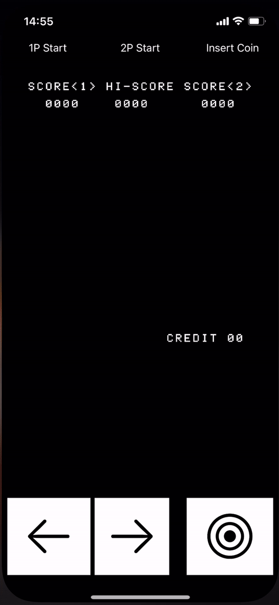

<p align="center">
    
</p>

<p align="center">
    
    <a href="https://swift.org/package-manager">
        
    </a>
     
</p>

**Emul8080r** is an Intel 8080 emulator written in Swift! Created initially to support a full emulation of the classic Space Invaders 👾 game on Apple platforms, found [here](https://github.com/timsearle/SpaceInvaders).

## Installation

### Swift Package Manager

#### Xcode
1. Open your project in Xcode
2. Go to File → Add Package Dependencies
3. Enter the repository URL: `https://github.com/timsearle/emul8080r`
4. Select the version and add to your target

#### Package.swift
```swift
dependencies: [
    .package(url: "https://github.com/timsearle/emul8080r", from: "1.0.0")
]
```

## Quick Start

```swift
import Emul8080r

// Implement a simple clock
struct SimpleClock: SystemClock {
    func currentMicroseconds() -> Double {
        return Date().timeIntervalSince1970 * 1_000_000
    }
}

// Create CPU with 64KB memory
let memory = Array(repeating: UInt8(0), count: 65536)
let cpu = CPU(memory: memory, systemClock: SimpleClock())

// Load ROM data
let romData: [UInt8] = // your ROM bytes here
cpu.load(romData)

// Execute instructions
do {
    try cpu.emulateCycle()
} catch {
    print("Emulation error: \(error)")
}
```

## Architecture Overview

The emulator is built with a modular design:

- **CPU**: Core processor logic handling instruction execution
- **State8080**: Manages registers, flags, and memory
- **Disassembler**: Provides debugging capabilities
- **IOBus Protocol**: Interface for hardware I/O operations
- **SystemClock Protocol**: Timing control for authentic speed emulation

The Intel 8080 supported 256 instructions and emul8080r handles this via a switch from `0x00` through to `0xff`.

## API Documentation

### Core Classes

#### `CPU`
The main emulator class that handles instruction execution and state management.

**Key Methods:**
- `init(memory: [UInt8], systemClock: SystemClock, safeMemoryBounds: Range<UInt8>? = nil)` - Initialize CPU with memory and clock
- `load(_ data: [UInt8])` - Load ROM data into memory
- `emulateCycle() throws` - Execute one CPU cycle
- `step() throws` - Execute one instruction and return its info

**Properties:**
- `state: State8080` - Current CPU state (registers, flags, memory)
- `bus: IOBus?` - I/O interface for hardware communication

#### `State8080`
Represents the complete state of the Intel 8080 processor.

**Key Components:**
- `registers: Registers` - CPU registers (A, B, C, D, E, H, L)
- `conditionBits: ConditionBits` - Status flags (zero, sign, parity, carry, aux_carry)
- `stackPointer: UInt16` - Stack pointer
- `programCounter: UInt16` - Program counter
- `memory: [UInt8]` - System memory

### Protocols

#### `SystemClock`
Implement this protocol to provide timing for authentic emulation speed.
```swift
protocol SystemClock {
    func currentMicroseconds() -> Double
}
```

#### `IOBus`
Implement this protocol to handle hardware I/O operations.
```swift
protocol IOBus: AnyObject {
    func machineIN(port: UInt8) -> UInt8
    func machineOUT(port: UInt8, accumulator: UInt8)
}
```

## Testing

Run the test suite with:
```bash
swift test
```

Build the package:
```bash
swift build
```

For Xcode development:
```bash
swift package generate-xcodeproj
```

### In action



## Project Status

**Implementation Progress:** ~75% complete (196 of 256 instructions implemented)

The emulator currently supports all instructions needed for Space Invaders and many other classic 8080 programs. Development is ongoing to implement the remaining instructions for full 8080 compatibility.

### Current Status
- ✅ All basic arithmetic and logical operations
- ✅ Memory operations and addressing modes  
- ✅ Jump, call, and return instructions
- ✅ Stack operations
- ⚠️ Some specialized instructions pending (see table below)
- ⚠️ Unit test coverage needs improvement

### Outstanding Instructions (60 remaining)**

| Instruction Value | Instruction Name |
| ------------------- | -------------------  |
| 0x08                    | ?       |
| 0x10                    | ?       |
| 0x17                    | RAL       |
| 0x18                    | ?       |
| 0x1c                    | INR E       |
| 0x1d                    | DCR E       |
| 0x20                    | ?      |
| 0x25                    | DCR H       |
| 0x28                    | ?       |
| 0x2d                    | DCR L       |
| 0x30                    | ?       |
| 0x33                    | INX SP       |
| 0x38                    | ?      |
| 0x39                    | DAD SP       |
| 0x3b                    | DCX SP      |
| 0x3f                     | CMC       |
| 0x76                    | HLT       |
| 0x98                    | SBB B       |
| 0x99                    | SBB C      |
| 0x9a                    | SBB D       |
| 0x9b                    | SBB E       |
| 0x9c                    | SBB H      |
| 0x9d                    | SBB L       |
| 0x9e                    | SBB M       |
| 0x9f                     | SBB A       |
| 0xc7                    | RST 0       |
| 0xcb                    | ?       |
| 0xce                    | ACI D8       |
| 0xcf                     | RST 1       |
| 0xd7                    | RST 2       |
| 0xd9                    | ?       |
| 0xdc                    | CC adr       |
| 0xdd                    | ?       |
| 0xdf                     | RST 3       |
| 0xe2                    | JPO adr       |
| 0xe4                    | CPO adr       |
| 0xe7                    | RST 4       |
| 0xea                    | JPE adr       |
| 0xec                    | CPE adr       |
| 0xed                    | ?       |
| 0xee                    | XRI D8       |
| 0xef                     | RST 5       |
| 0xf2                     | JP adr       |
| 0xf4                     | CP adr       |
| 0xf7                     | RST 6       |
| 0xf9                     | SPHL       |
| 0xfc                     | CM adr       |
| 0xfd                     | ?       |
| 0xff                      | RST 7       |

### Thanks

* [emulator101.com](https://www.emulator101.com) - if it wasn't for this site, this almost certainly would've taken me far longer to produce.
* [classiccmp.org](http://www.classiccmp.org/dunfield/r/8080.txt) - a brilliant, high-level mapping of instruction values to descriptions
* [computerarcheology.com](http://computerarcheology.com/Arcade/SpaceInvaders/) - this site proved invaluable for debugging my implementation, understanding ROM and RAM ranges and just how Space Invaders originally operated on the 8080 and its associated hardware, helping me to build my own version [here](https://github.com/timsearle/SpaceInvaders).
* <a href="Files/8080asm.pdf"> Official Intel 8080 Assembly manual</a>

### Contributing

Happy to receive any and all contributions relating directly to making this package a more accurate reflection of an Intel 8080 processor! Please do raise PRs including instruction implementations/bug fixes/enhancements alongside a unit test.
